# Dimensional Modeling Project with Azure PostgreSQL, Airbyte, Docker, dbt Core, and Looker

## Overview
This project builds a star schema for the Superstore sample on PostgreSQL. The files in `data/` are the source: orders, returns, and regional managers. Docker runs a local Postgres and Airbyte. Airbyte loads the files into Postgres, with Azure Database for PostgreSQL as the shared warehouse. dbt Core turns the raw tables into the star schema, and Looker explores that schema.

The ingestion notes below are the start of the Azure and Airbyte steps. Docker, dbt, and Looker are the remaining work.

## Plan

Excel files go through Airbyte into a `raw` schema, then through dbt into `staging` and `marts`. Looker reads `marts` only.

### 1. Docker
Add a Compose file that starts Postgres for local development and Airbyte for ingestion. Keep passwords in `.env` (already gitignored). `profiles.yml` stays local too; commit `profiles.yml.example` when the dbt project exists.

Use this local database for day-to-day `dbt build`. Azure is the second target, for a shared environment.

### 2. Azure PostgreSQL
Create an Azure Database for PostgreSQL flexible server and a database for this project. Require SSL (`sslmode=require`) and limit the firewall to your IP and to Airbyte. Store the host, user, and password in environment variables, not in the repo.

Create three schemas: `raw` for Airbyte, `staging` and `marts` for dbt. The DBeaver steps later in this README are the client check for that server.

### 3. Airbyte
Run Airbyte from Docker. Add a file source for the three workbooks in `data/`:

| File | Rows | What it is |
| --- | --- | --- |
| `Orders.xls` | 9,994 lines, 5,009 orders | One row per order line (`Row ID`) |
| `Returns.xls` | 800 rows, 296 order ids | A returned flag. Every id exists on an order. |
| `People.xls` | 4 rows | One regional manager per region |

Send them to the Postgres destination, schema `raw`, on a manual sync until the dbt models are stable. Point the destination at local Postgres first, then at Azure with the same stream names.

Upgrade the Postgres destination before writing dbt sources. The screenshot in this README still shows destination v0.4.0 with a pending move to Destinations V2, and that upgrade changes the shape of the landed tables. The screenshots from `img/7.jpg` through `img/16.jpg` cover the file source and the destination form.

### 4. dbt Core
A dbt project with two outputs in `profiles.yml`: `dev` (Docker Postgres) and `azure` (the flexible server). Packages can wait until a test needs `dbt_utils`.

**Staging** casts types and sets grain. No business calculations here.

- `stg_orders` renames columns, turns Excel date serials into dates (order dates run from 2018-01-03 through 2021-12-30; ship dates run through 2022-01-05), stores postal code as text zero-padded to 5 characters, and casts sales, quantity, discount, and profit to numeric. Eleven postal codes are blank, all in Vermont; those stay null.
- `stg_returns` is one row per `order_id` with `returned = true`. The sheet repeats order ids (800 rows, 296 ids) because it was expanded to line level and the line key was dropped.
- `stg_people` is `regional_manager` and `region`.

**Marts** are the star schema.

- `dim_date` covers 2018-01-03 through 2022-01-05 so both order date and ship date resolve.
- `dim_customer` is one row per customer id (793 customers).
- `dim_product` is one row per product id (1,862 products), with category, sub-category, and product name.
- `dim_location` is city, state, postal code, and region. Country is United States on every line, so it is an attribute here.
- `dim_region_manager` is the four people, joined to location on region.
- `fact_order_line` is one row per `Row ID`. Measures are sales, quantity, discount, and profit. `is_returned` comes from `stg_returns` at order grain. Foreign keys point at the dimensions.

`Row ID` is the fact key. `Order ID` plus `Product ID` repeats on 8 lines, so that pair cannot be the key. Ship date is on or after order date on every line.

**Tests** to ship with the models: `unique` and `not_null` on `row_id`; every return `order_id` exists on orders; `ship_date >= order_date`; accepted values for segment, region, and ship mode; a null postal code is allowed only for Vermont.

`dbt build` should pass on `dev`, then on `azure`.

### 5. Looker
Commit LookML for the marts: one view per dimension, one view for `fact_order_line`, and an explore that joins them. Looker connects to the `marts` schema on Azure (or to local Postgres while developing).

Measures on the fact:

- Sales, quantity, and profit as sums.
- Margin as total profit divided by total sales. On this extract that ratio is 286,397 / 2,297,201 (12.5%).
- Return rate as distinct returned orders divided by distinct orders (296 / 5,009). The 800 return rows are repeats of those 296 orders.
- Keep the 1,871 lines with negative profit. They are losses on the extract.

The file has a discount rate and a profit amount, and no cost column. Leave discount as a rate on the line until a cost field exists.

### Done when
- `docker compose up` gives a local Postgres and Airbyte.
- A manual Airbyte sync lands the three files in `raw` locally, and the same sync lands them in Azure.
- `dbt build` passes on both targets, including the grain tests above.
- The Looker explore returns sales, margin, and return rate at line grain and at order grain.

## Ingesting data into Azure PostgreSQL
  
**Connect to PostgreSQL using DBeaver**

   1. Install the appropriate version of [DBeaver](https://dbeaver.io/download/) for your system.
   2. Open Dbeaver and create **New Database Connection**. 
   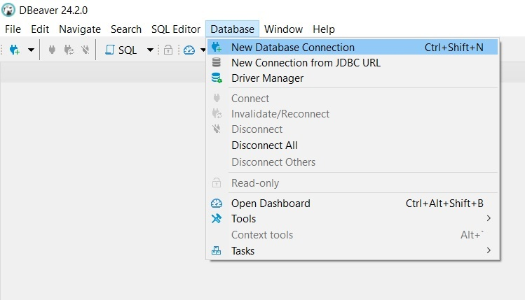
   3. Select **PostgreSQL** from the list of database drivers, then click **Next** to proceed.
   4. Enter the connection details as prompted in the database connection window.
   ```bash
      - Host: your-db-host
      - Port: 5432
      - Database: your-db-name
      - Username: your-db-user
      - Password: your-db-password
   ```
   5. Click **Test Connection** to ensure that the connection details are correct. Click **Finish** to save the connection.

   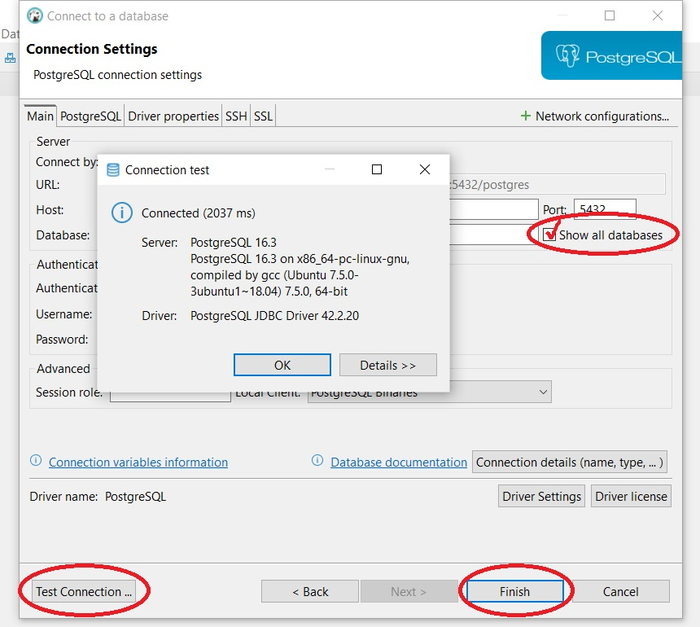

Don't forget to check the 'Show all databases' option so that the new database will appear in the Database Navigator's list once it is created.

**Use Airbyte for data ingestion**

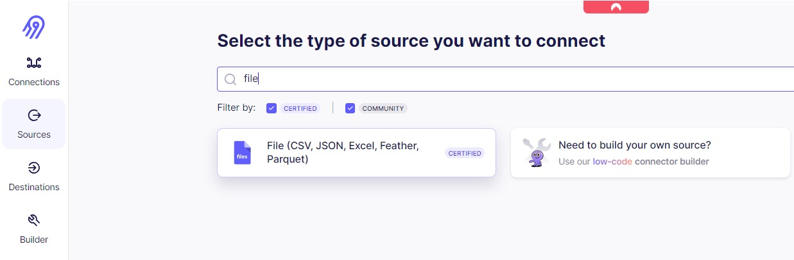
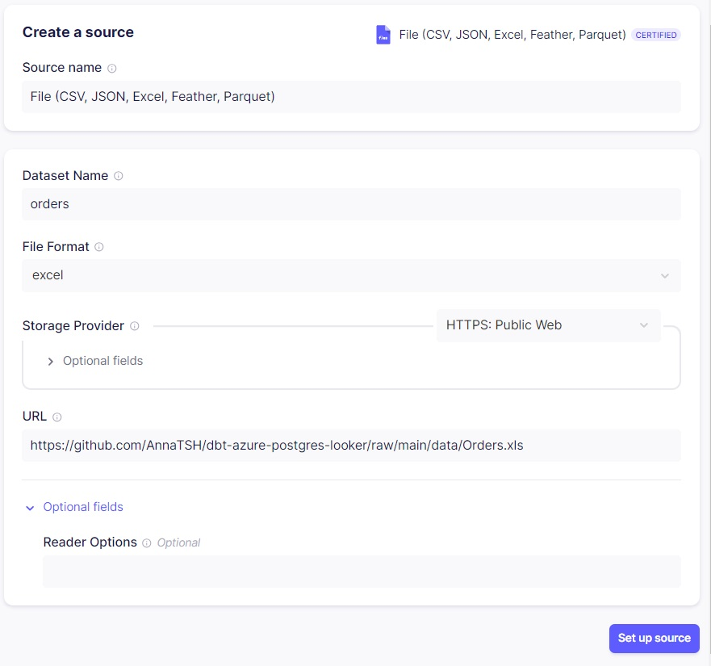
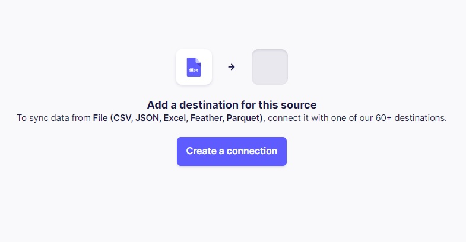
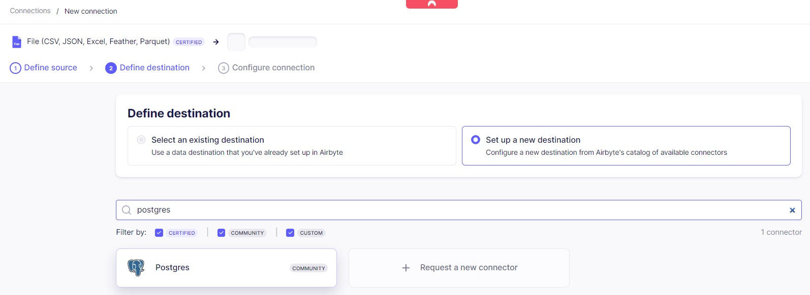

You'll need the following information to configure the Postgres destination (the same we used to connect DBeaver):

- **Host**: The host name of the server.
- **Port**: The port number the server is listening on. Defaults to the PostgreSQL™ standard port number (5432).
- **Username**
- **Password**
- **Default Schema Name**: Specify the schema (or several schemas separated by commas) to be set in the search-path.
- **Database**: The database name. The default is to connect to a database with the same name as the user name.

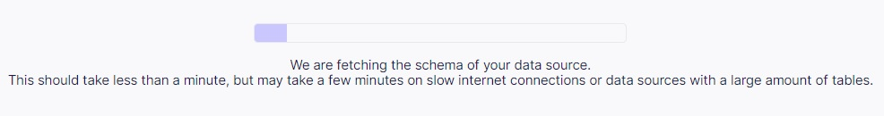

I only changed the Name of the connection and Schedule type to Manual and click Set up connection.

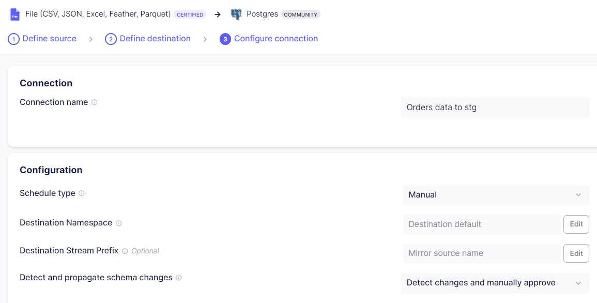
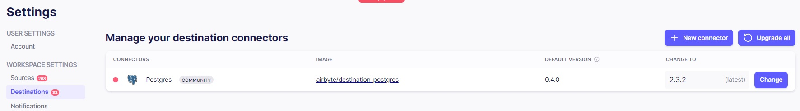
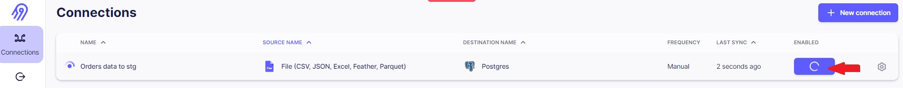

Go to Settings and make sure both Source and Destination you use are upgraded to the latest version.

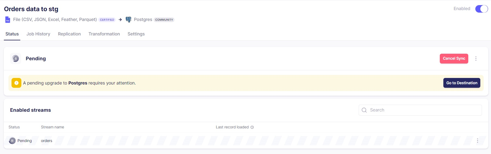
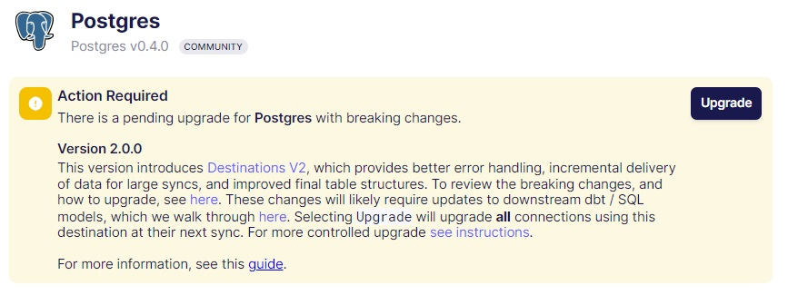